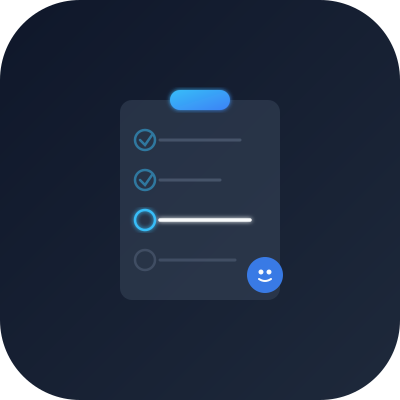

# 管你屁事

<div align="center">
  
  <p><strong>Agent 优先的贴身管家式事务中心</strong></p>
  <p>屁大点事都帮你管 — 让所有 AI Agent 知道自己在做什么、还有哪些没做完、资料在哪里</p>
</div>

---

## 🎯 这是什么

**管你屁事** 是一个**贴身管家式**的事务进度中心:
- 你告诉它任何事,它**实时记录**
- Agent 随时连上它,就知道**该做什么、做到哪了**
- 支持**自然语言检索**,不用记在哪个项目
- 能**联通 Agent 处理执行层事务**(文件登记、提醒推送、条例检查)

### 为什么叫"管你屁事"

- **屁大点事都帮你管** — 从产品上线到续费订阅,从会议纪要到差旅报销,大事小事,统统记下
- **有趣有梗** — 灵感来自经典熊猫头表情包"关你屁事",轻松幽默的产品调性
- **Agent 协作** — 不是冷冰冰的工具,是你的贴身管家,什么屁事都能交给它

### 核心理念

1. **Agent 优先**: 任何 Agent(Claude Code、Cursor、Codex、豆包、龙虾…)连上来,**第一次调用就是熟练工**,不用探索、不用记忆、不用学习。
2. **单一真相源**: 所有进度、资料位置、拍板决定都在这里,不散落在聊天记录里。
3. **贴身管家**: 不是被动工具,会主动提醒到期、检测拖延、反向管理 Agent("这个任务拖 3 次了,要不要换个做法?")。

---

## ✨ 核心特性

### 第一批:看板与阶段门
- **项目看板**: IT 项目/公司事务/客户项目/知识库,每个项目独立清单
- **阶段门**: 必须完成某些关键项才能进入下一阶段(例如:产品上线前必须有备份恢复演练)
- **防流水账**: 同一事项多次进展自动合并,完成证据自动核实
- **依赖管理**: "A 做完才能做 B",自动提醒解锁

### 第二批:公司事务台账
- **资产**: 服务器/域名/证书/软件订阅,到期自动提醒
- **采购**: 供应商/合同/发票/收货,全流程追踪
- **客户关系**: 线索→商机→成交→续费,每次沟通都有记录
- **差旅**: 行程/住宿/报销,一站式管理
- **日历**: 会议/截止日/生日提醒,与清单联动

### 第三批:秘书层
- **今日**: 自动汇总今天要做的(逾期、到期、P0、已计划、在等别人)
- **拍板队列**: 需要决策的事项(政策待批、被阻塞项、客户下一步)
- **拖延检测**: 同一任务在"今日"出现 3 次?给出拖延提示和建议
- **每周复盘**: 本周完成了什么、下周 Top 3、反思与调整

### 第四批:随手记
- **飞书消息**: 发条消息给机器人→AI 整理成草稿清单→你确认→自动归档到项目
- **快捷指令**: iPhone/Mac 快捷指令投递,语音/文字都行
- **网页收集**: 开个网页窗口,随手贴,定时整理
- **到点提醒**: "明天下午 3 点提醒我给客户打电话"→时间到了推飞书卡片

---

## 🚀 快速开始

### 1. 本地运行(推荐新手)

```bash
# 1. 克隆仓库
git clone https://github.com/sjj79475067-max/ember.git
cd ember

# 2. 生成密钥
echo "SESSION_SECRET=$(openssl rand -base64 32)" > .env
echo "APP_URL=http://localhost:3000" >> .env

# 3. 启动
docker compose up -d

# 4. 访问 http://localhost:3000
```

首次访问会要求设置管理员账号。

### 2. Agent 接入

"管你屁事"提供**双通道**接入:

#### MCP (推荐,Claude Code/Cursor/Cline)
```bash
# Claude Code
claude mcp add \
  --name guannipi \
  --transport http \
  --url http://localhost:3000/api/mcp \
  --header "Authorization: Bearer <你的token>"

# 获取 token:访问 http://localhost:3000/settings,创建 API Token
```

#### REST (通用,任何 Agent)
```bash
# 1. 读取接入指南
curl http://localhost:3000/llms.txt

# 2. Onboard(Agent 首次连接,获取全局上下文)
curl http://localhost:3000/api/v1/agent/onboard \
  -H "Authorization: Bearer <token>"

# 返回:当前项目、待办提醒、条例摘要、下一步建议
```

更多接入方式见 [docs/AGENT-GUIDE.md](docs/AGENT-GUIDE.md)

---

## 🏗️ 架构

```
┌─────────────────────────────────────────────────┐
│  Web UI(React 19 + Tailwind v4 + shadcn/ui)   │
├─────────────────────────────────────────────────┤
│  API Layer                                      │
│  ├─ /api/mcp         (MCP Streamable HTTP)    │
│  ├─ /api/v1/*        (REST for all agents)    │
│  └─ /api/capture/*   (Feishu/Shortcuts)       │
├─────────────────────────────────────────────────┤
│  Service Layer (business logic)                 │
│  ├─ items/board/milestones/requirements        │
│  ├─ assets/purchases/crm/trips/calendar        │
│  ├─ secretary/reminders/policies/maintenance   │
│  └─ capture(parse/channel/scheduler)           │
├─────────────────────────────────────────────────┤
│  Data Layer                                     │
│  ├─ SQLite(better-sqlite3) + Drizzle ORM      │
│  └─ 审计日志/变更历史/版本控制                    │
└─────────────────────────────────────────────────┘
```

- **技术栈**: Next.js 15 App Router + TypeScript + SQLite
- **部署**: Docker 单容器(755MB),内存占用 < 512MB
- **数据**: 文件不存中心,只登记位置(机器名/路径/哈希/最近核验时间)
- **AI**: 可选(仅用于导入拆分、陈旧检测、日报周报),可完全关闭

---

## 📖 文档

- [SPEC-BATCH1.md](docs/SPEC-BATCH1.md) — 看板与阶段门详细规格
- [SPEC-BATCH2.md](docs/SPEC-BATCH2.md) — 公司事务台账详细规格
- [SPEC-BATCH3.md](docs/SPEC-BATCH3.md) — 秘书层详细规格
- [SPEC-BATCH4.md](docs/SPEC-BATCH4.md) — 随手记详细规格
- [AGENT-GUIDE.md](docs/AGENT-GUIDE.md) — Agent 接入完整指南
- [MAINTAINER.md](docs/MAINTAINER.md) — 维护手册(改代码前必读)
- [DEPLOY.md](docs/DEPLOY.md) — 三种部署方案详解
- [ARCHITECTURE.md](docs/ARCHITECTURE.md) — 架构设计与决策记录

---

## 🔧 开发

```bash
cd apps/web

# 类型检查
npx tsc --noEmit -p .

# 单元测试(52 个)
npx vitest run

# 开发服务器(3100 端口,独立数据库)
DATABASE_URL=file:/tmp/guannipi-dev/db.sqlite \
APP_URL=http://localhost:3100 \
npx next dev -p 3100

# 端到端测试(6 个,仅对 3100)
ADMIN_EMAIL=dev@test.local \
ADMIN_PASS="$(cat /tmp/guannipi-dev/pw)" \
npx playwright test
```

### 红线(改代码前必读)

1. **不对正式实例做测试**: 正式实例端口 3000,测试只用 3100
2. **部署前先备份**: `bash scripts/backup.sh`
3. **改动前先读维护账本**: `node scripts/maintainer-brief.mjs`
4. **新功能先记需求**: 在 EMBER 项目里记一条需求,再动手
5. **不存任何密码或密钥原文**: 台账只记位置

详见 [docs/MAINTAINER.md](docs/MAINTAINER.md)

---

## 🌐 部署

三种方案任选:

### 方案 1: Cloudflare Tunnel(推荐新手)
- 免费、零配置、自动 HTTPS
- 5 分钟从本机到公网

### 方案 2: VPS + Nginx + Let's Encrypt
- 完全自主、性能最优
- 需要域名和 VPS

### 方案 3: Cloudflare 代理模式
- 隐藏源站 IP、抗 DDoS
- 本项目实际使用方案

详见 [docs/DEPLOY.md](docs/DEPLOY.md)

---

## 🤝 贡献

欢迎提 Issue 和 PR!改代码前请:

1. 读 [docs/MAINTAINER.md](docs/MAINTAINER.md) 了解架构和红线
2. 跑 `node scripts/maintainer-brief.mjs` 看维护账本
3. 确保单元测试和 e2e 测试全绿
4. 提交信息写清楚做了什么、为什么

---

## 📜 许可

MIT License — 随便用,随便改,随便商用。

---

## 💬 一句话总结

**屁大点事都帮你管 — 让 Agent 成为你的贴身管家,而不是对话框里的临时工。**

---

<div align="center">
  <sub>灵感来自经典熊猫头表情包 · Made with ❤️ and a sense of humor</sub>
</div>
